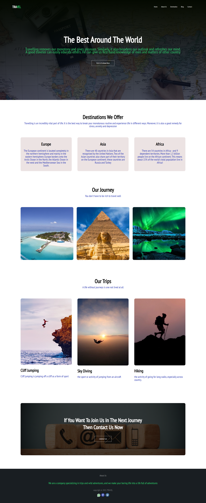

# 🌍 Travel Agency Website

## 📌 About the Project

A travel agency website designed to showcase travel destinations, adventure trips, and tourism services.

This project demonstrates my front-end development skills using HTML, CSS, and JavaScript.

## 🚀 Live Demo

[Visit the Website](https://mohamedhossam107.github.io/travel-agency-website/)

## ✨ Features

- Full-screen hero section
- Travel destination cards
- Interactive image galleries
- Smooth CSS hover animations
- Responsive layout using media queries
- Mobile navigation menu
- Contact section
- Footer with social media icons

## 🛠️ Technologies Used

- HTML5
- CSS3
- JavaScript
- CSS Flexbox
- Google Fonts
- Font Awesome

## 📚 What I Learned

- Building multi-section website layouts
- Responsive web design
- CSS animations and transitions
- JavaScript DOM manipulation
- Mobile navigation implementation
- Website deployment using GitHub Pages

## 👨‍💻 Author

Mohamed Hossam

---

⭐ Thank you for checking out my project!

## 📸 Project Preview

